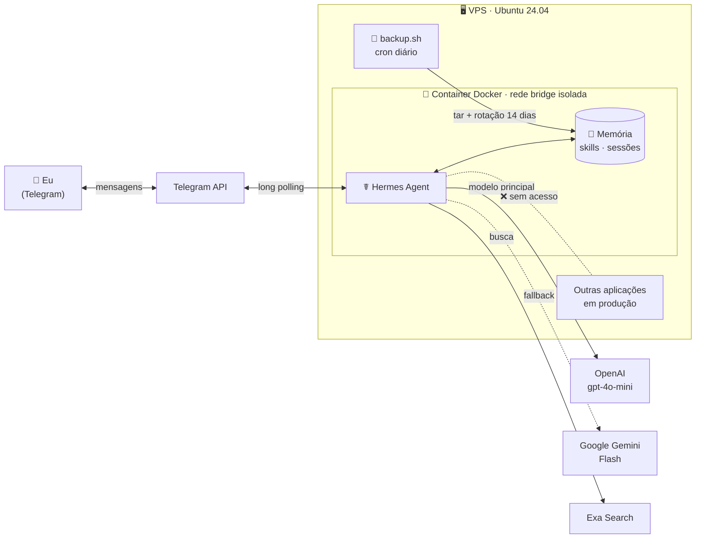
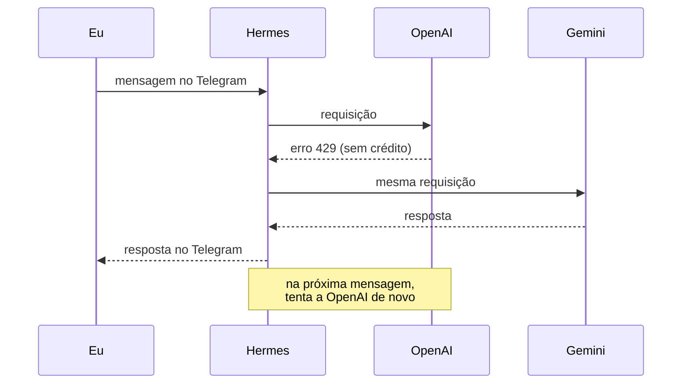

<div align="center">

# ☤ Hermes Agent: meu assistente pessoal de IA

**Um agente de IA autônomo, rodando 24h numa VPS, que conversa comigo pelo Telegram, lembra do que eu digo e executa tarefas de verdade.**


[O que ele faz](#-o-que-ele-faz) ·
[Arquitetura](#️-arquitetura) ·
[Segurança](#️-segurança) ·
[Instalação](#-instalação) ·
[Operação](#-operação) ·
[Aprendizados](#-aprendizados)

</div>

---

## 💡 Sobre o projeto

Eu queria um assistente que fosse **meu**: que rodasse no meu servidor, guardasse a memória comigo e fizesse mais do que responder perguntas. Para isso, instalei e configurei o [Hermes Agent](https://github.com/NousResearch/hermes-agent), um agente open source da Nous Research, em Docker numa VPS que também hospeda outras aplicações em produção.

O desafio não foi só "fazer funcionar". Foi fazer funcionar **sem colocar em risco o que já rodava no servidor**, com custo controlado e sem depender de um único fornecedor de IA.

---

## ✨ O que ele faz

| | Recurso | Na prática |
|---|---|---|
| 🧠 | **Memória persistente** | Lembra das minhas preferências e do contexto entre conversas, mesmo depois de reinícios e atualizações |
| 📚 | **Skills** | Cria e reutiliza habilidades para tarefas recorrentes |
| 🔍 | **Pesquisa na web** | Busca e lê páginas para responder com informação atual |
| 🌐 | **Navegador** | Abre sites, clica e lê conteúdo dinâmico com um Chromium headless |
| ⚡ | **Execução de código** | Roda comandos e scripts num ambiente isolado |
| ⏰ | **Tarefas agendadas** | Executa rotinas sozinho e me manda o resultado no Telegram |
| 🔁 | **Troca automática de modelo** | Se a OpenAI falhar ou ficar sem crédito, o Gemini assume na hora |
| 🔒 | **Acesso exclusivo** | Só responde ao meu usuário do Telegram |

---

## 🏗️ Arquitetura



### Como funciona o fallback



### Stack

| Camada | Tecnologia |
|---|---|
| Agente | [Hermes Agent](https://github.com/NousResearch/hermes-agent) (Python, supervisionado por s6-overlay) |
| Infraestrutura | VPS Ubuntu 24.04 · Docker 29 · Docker Compose v5 |
| Modelos | OpenAI `gpt-4o-mini` (principal) · Google Gemini Flash (fallback) |
| Canal | Telegram Bot API (long polling, sem portas abertas) |
| Ferramentas | Exa (busca) · Chromium headless (navegador) |
| Operação | Bash · cron · tar |

---

## 🛡️ Segurança

O agente roda **no mesmo servidor de aplicações em produção**. Por isso a segurança foi pensada em camadas:

```
Telegram  →  allowlist: só o meu ID
          →  ferramentas mínimas: sem controle de desktop, imagem ou áudio
Rede      →  bridge isolada: o agente não alcança as outras aplicações
Container →  usuário sem root (UID 10000)
Dados     →  .env e backups com permissão 600
Painel    →  porta 9119 não exposta
Custos    →  saldo pré-pago + limite mensal + fallback
```

**Isolamento testado na prática.** Antes da mudança de rede, o agente alcançava os bancos e APIs das outras aplicações em `127.0.0.1`. Depois de trocar `network_mode: host` por `bridge`:

```bash
$ docker exec hermes bash -c 'echo > /dev/tcp/127.0.0.1/5432 && echo ABERTO'
bash: connect: Connection refused          # ✅ bloqueado

$ docker exec hermes timeout 5 bash -c 'echo > /dev/tcp/172.17.0.1/8081'; echo "codigo=$?"
codigo=124                                 # ✅ bloqueado (timeout)
```

---

## 🚀 Instalação

<details>
<summary><b>Passo a passo completo</b></summary>

### Estrutura

```
/opt/hermes/
├── app/                          ← clone oficial (não editar, exceto o override)
│   └── docker-compose.override.yml
├── data/                         ← "mente" do agente (NUNCA no git)
│   ├── .env                      ← chaves de API
│   ├── config.yaml
│   └── memories/ sessions/ skills/
├── backups/                      ← data-AAAA-MM-DD.tar.gz (NUNCA no git)
├── backup.sh
└── backup.log
/root/.hermes -> /opt/hermes/data ← link simbólico
```

### 1. Baixar o código e criar a pasta de dados

```bash
mkdir -p /opt/hermes
cd /opt/hermes
git clone https://github.com/NousResearch/hermes-agent.git app
mkdir -p data
```

> `git clone --depth 1` baixa só a versão atual (o histórico completo tem ~1,2 GB).

### 2. Construir a imagem

```bash
cd /opt/hermes/app
docker compose build
```

### 3. Apontar o volume para `/opt/hermes/data`

O compose oficial monta `~/.hermes`. Em vez de editar o arquivo oficial (o que geraria conflito no `git pull`), criei um link simbólico:

```bash
ln -s /opt/hermes/data /root/.hermes
chown -R 10000:10000 /opt/hermes/data
```

### 4. Isolar a rede

Copie [`docker-compose.override.yml`](docker-compose.override.yml) para `/opt/hermes/app/`. O Compose lê esse arquivo automaticamente e troca `host` por `bridge`.

```bash
docker compose config | grep network_mode   # "bridge" duas vezes
```

### 5. Assistente de configuração

```bash
docker compose run --rm -it gateway setup
```

| Tela | Escolha |
|---|---|
| Tipo de setup | Full setup |
| Provedor / modelo | OpenAI · `gpt-4o-mini` |
| Terminal backend | Local (= dentro do container) |
| Plataforma | Telegram, com allowlist do meu ID |
| Ferramentas | Padrão, sem Computer Use, Image Generation e TTS |
| Navegador / busca | Local Browser · Exa Free |
| Telemetria | Desligada |

### 6. Fallback para o Gemini

```bash
docker compose run --rm -it gateway fallback add    # provider: gemini, modelo Flash
docker compose run --rm gateway fallback list
```

### 7. Subir o agente

```bash
docker compose up -d gateway
docker logs --tail 40 hermes    # "Connected to Telegram (polling mode)"
```

</details>

---

## 🔧 Operação

<details>
<summary><b>Comandos do dia a dia</b></summary>

```bash
cd /opt/hermes/app
docker compose ps                     # está rodando?
docker logs -f hermes                 # log ao vivo
docker stats --no-stream hermes       # CPU e RAM
docker compose restart gateway        # depois de mudar a config
docker compose run --rm -it gateway tools   # ligar/desligar ferramentas
docker compose run --rm -it gateway model   # trocar o modelo
```

> Editar `config.yaml` ou o compose **não altera** o container em execução: é preciso `restart` ou `up -d`.

</details>

<details>
<summary><b>Backup automático e restauração</b></summary>

O [`backup.sh`](backup.sh) para o agente, compacta a pasta de dados, religa o agente (mesmo em caso de erro, graças ao `trap`) e apaga backups com mais de 14 dias.

```
30 3 * * * /opt/hermes/backup.sh >> /opt/hermes/backup.log 2>&1
```

Restaurar:

```bash
docker compose stop gateway
mv /opt/hermes/data /opt/hermes/data.quebrado
tar xzf /opt/hermes/backups/data-AAAA-MM-DD.tar.gz -C /opt/hermes
docker compose start gateway
```

</details>

<details>
<summary><b>Atualização</b></summary>

Ordem: **backup → pull → build → up**.

```bash
/opt/hermes/backup.sh
cd /opt/hermes/app
git fetch && git log --oneline HEAD..origin/main | head -20
git pull
docker compose build
docker compose up -d gateway
docker image prune -f
```

</details>

<details>
<summary><b>Custos</b></summary>

`gpt-4o-mini`: US$ 0,15 por 1M tokens de entrada e US$ 0,60 por 1M de saída ([preços atuais](https://openai.com/api/pricing)).

| Uso | Estimativa |
|---|---|
| Leve (~20 conversas/dia) | ~US$ 2/mês |
| Moderado | ~US$ 5–10/mês |
| Intenso (navegador, cron) | US$ 20+/mês |

Um agente gasta mais que um chat comum: cada chamada envia instruções, descrição das ferramentas e histórico. Proteções: saldo pré-pago sem recarga automática e limite mensal.

</details>

---

## 🎓 Aprendizados

Problemas reais que encontrei e como resolvi:

| Sintoma | Causa | Solução |
|---|---|---|
| Comandos colados chegavam quebrados | O terminal quebrava linhas longas | Comandos curtos e edição com `nano` |
| Menu mostrava o navegador errado | Rótulo ambíguo na interface | Li o código e os testes do projeto: a config real já estava certa |
| O agente alcançava bancos de outras apps | `network_mode: host` | Rede `bridge` via override, com teste antes e depois |
| Bot parou de responder | API da OpenAI sem créditos | Fallback automático para o Gemini |
| Fallback com erro 404 | Modelo do Gemini descontinuado | 404 = "não encontrado", não chave errada: troquei o modelo |

**O que levo deste projeto:** verificar em vez de supor, investigar no código antes de "consertar", e nunca depender de uma única camada de proteção.

---

## 🗺️ Próximos passos

- [ ] Canal no WhatsApp, com número dedicado e ferramentas restritas
- [ ] Teste periódico de restauração do backup
- [ ] Rotinas agendadas (resumo diário de notícias e tarefas)

---

<div align="center">

Feito com ☕ e muito `docker logs` · baseado no [Hermes Agent](https://github.com/NousResearch/hermes-agent) da Nous Research

</div>
